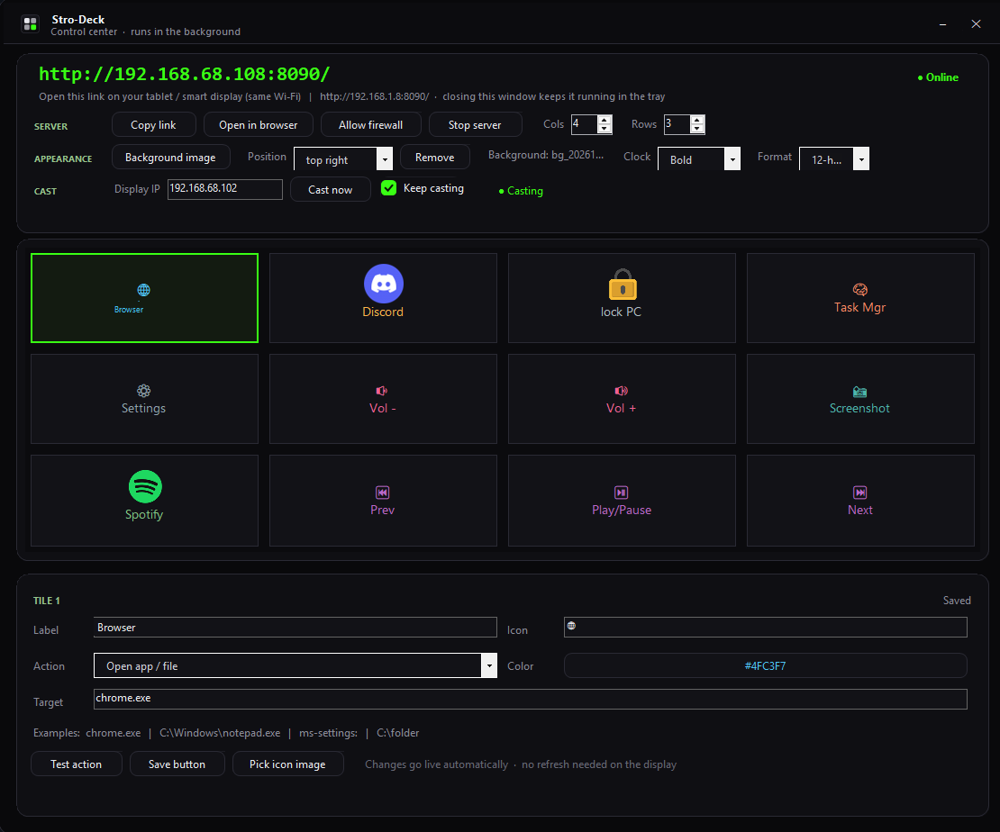
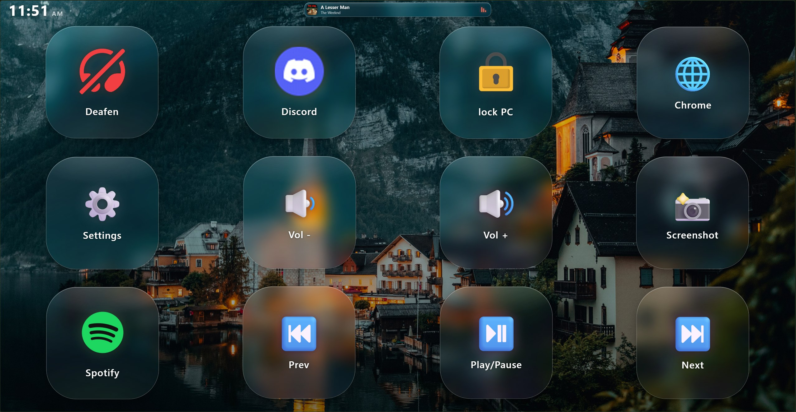
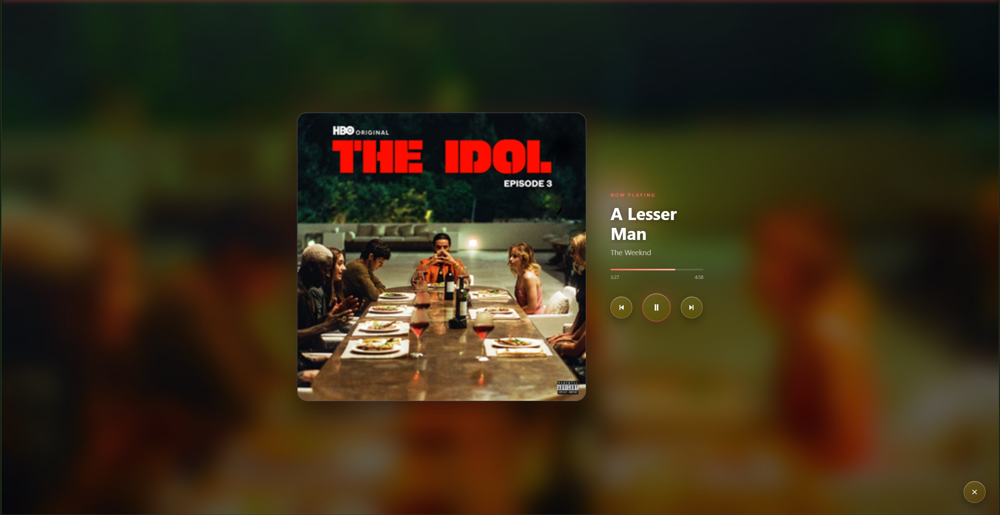

# Stro-Deck

**Version 1.0.1**

Stro-Deck turns a Windows computer into a customizable remote control. It runs a small web server on the computer and serves a button grid to a browser on another device on the same local network. Configure buttons in the desktop app; pressing a button in the browser performs its configured action on the Windows computer.

## Screenshots

<p align="center">
  
  <br>
  <em>Configure buttons, appearance, pairing, and optional startup behavior in the Windows app.</em>
</p>

<p align="center">
  
  <br>
  <em>Open Spotify and control the active media session from the same touch-friendly deck.</em>
</p>

<p align="center">
  
  <br>
  <em>Tap the now-playing banner to see artwork, track details, progress, and playback controls.</em>
</p>

Try Stro-Deck and share your setup: **#Windows #Spotify #SmartHome #OpenSource #NestHub**

## Requirements

- Windows
- A phone, tablet, or other browser-enabled device on the same local network
- Windows PowerShell and .NET Framework 4.x to run the app
- The .NET Framework C# compiler (`csc.exe`) to rebuild from source
- Optional: Google Nest Hub with WebView remote debugging enabled
- Optional: OpenCode and Windows Terminal for the Greeting project launcher described below

## Run the application

1. Start `Stro-Deck.exe`.
2. The desktop app discovers the computer's active IPv4 addresses but shows only a privacy-safe placeholder such as `http://<computer-ip>:8090/`. Select **Copy link** to copy the current usable URL; the app uses that real URL internally for opening and casting without displaying the IP.
3. Open that address in a browser on the other device. The deck can be displayed without pairing; press a button once and enter the 8-digit pairing code shown in the desktop app. The browser keeps an HttpOnly session cookie for seven days.
4. If Windows Firewall prompts you, allow the app on your trusted private network.

The server listens on port 8090 by default and tries the next 19 ports if that port is unavailable. It must remain reachable on LAN interfaces for phones, tablets, and the Nest Hub; the app validates request Host and Origin values and requires pairing for actions. The computer's address is discovered at runtime and is not saved to the app configuration or rendered in the desktop UI. If there is no usable LAN address, the app indicates that only a local URL is available.

### Spotify and media controls

Stro-Deck reads the active Windows media session, preferring Spotify when it is available. The deck can show the track, artist, album artwork, and playback progress; tap the now-playing banner to open the larger player and use play/pause, previous, and next. The default deck also includes a Spotify launch tile and media buttons. Install and sign in to Spotify separately; playback metadata and control availability depend on Spotify exposing a Windows media session. Other media apps that use Windows media controls can also appear when Spotify is not active.

Pair each browser before accessing track details, album artwork, or playback controls. The desktop app and server continue to work when no media session is active.

## How it works

1. `Program.cs` starts the Windows Forms desktop application.
2. `MainForm.cs` provides the button editor, server controls, and configuration persistence.
3. `Deck.cs` loads the deck settings, runs the local HTTP server, and dispatches button actions.
4. `deck.html` is embedded into the executable and rendered by the remote device's browser. The page requests display state from `/api/state` and sends paired button presses to `/api/press`.
5. Button actions run on the Windows computer. They can open apps and websites, run CMD or PowerShell commands, send keyboard/media input, type text, or perform power actions.

The configuration is stored in `deck-config.txt` beside the executable and is managed by the desktop app. The app creates default buttons when no configuration exists.

## Customize the deck

Select a button in the desktop app, edit its label, icon, color, action, and target, then select **Save button**. Use **Test action** to try an action on the computer. Drag buttons to swap their positions, or change the number of columns and rows.

The editor can also select image icons and a background image. Images are copied into the `icons` and `backgrounds` folders so the web page can serve them. The background position, clock display, and other appearance options are configurable in the app.

Available action types include:

| Action | Example target | Result |
|---|---|---|
| Open app / file | `notepad.exe`, `C:\Work`, `ms-settings:` | Opens an app, file, folder, or Windows URI |
| Open website | `https://example.com` | Opens a website |
| Run CMD command | `explorer C:\Work` | Runs a command on the Windows computer |
| Run PowerShell | `Get-Process` | Runs a PowerShell command |
| Media key | `play`, `next`, `mute`, `volup` | Sends a media control |
| Send keys | `win+shift+s`, `ctrl+shift+esc` | Sends a keyboard shortcut |
| Type text | `Hello` | Types text into the active window |
| System action | `lock`, `sleep`, `monitoroff`, `shutdown`, `restart` | Performs the selected system action |

### Launch OpenCode in the Greeting project

To add an OpenCode button:

1. Confirm OpenCode is installed and available from a terminal as `opencode`. Install Windows Terminal if you want the button to open a visible terminal window.
2. In the desktop app, select an unused button and set its label to `OpenCode`, choose an icon, and set **Action** to **Run CMD command**.
3. Set **Target** to the following command, replacing the example path if your `Greeting` project is elsewhere:

   ```cmd
   start "" wt.exe -d "%USERPROFILE%\Documents\Greeting" opencode
   ```

4. Save the button and select **Test action**. Pressing the button opens Windows Terminal in the `Greeting` project directory and starts OpenCode there.

This button launches OpenCode in the existing project folder; it does not create or copy the `Greeting` project.

## Google Nest Hub

There are two different ways to use the Hub with this project. The MCP server controls Google Cast playback; the Fuchsia WebView scripts inspect or navigate a debuggable WebView. They are separate tools, and enabling WebView debugging is not required for casting.

### Option A: Cast Stro-Deck with the MCP server

This is the simplest way to show the Stro-Deck web page on the Hub.

1. Connect the computer and Hub to the same local network. The Hub must be able to reach Stro-Deck's active port.
2. Start `Stro-Deck.exe` and select **Copy link** to copy the current Stro-Deck URL. If port 8090 is busy, the app may use another port through 8109.
3. Open PowerShell in the Stro-Deck folder and run the setup command. Replace these example addresses with the Hub IP and URL you copied:

   ```powershell
   powershell -ExecutionPolicy Bypass -File .\setup_mcp.ps1 -HubIp 192.0.2.20 -DeckUrl http://192.0.2.10:8090/
   ```

   The addresses above are reserved for documentation (`192.0.2.0/24`); replace both with the Hub address and current URL displayed by your own devices before running the command.

4. Restart Antigravity or reload its MCP servers. The server runs over standard input/output; you do not need to keep a separate terminal window open.
5. To verify the setup safely from PowerShell, run:

   ```powershell
   py -3 .\test_mcp_stdio.py
   ```

   Run the local address-selection checks with `powershell -ExecutionPolicy Bypass -File .\test_network_selection.ps1` and the HTTP authorization checks with `powershell -ExecutionPolicy Bypass -File .\test_deck_server.ps1`. The setup script installs compatible dependencies and adds `stro-deck-nest-hub` to Antigravity's MCP configuration at `%USERPROFILE%\.gemini\config\mcp_config.json`, preserving other MCP servers. The MCP sandbox test uses a temporary fake `catt` command and sends no commands to the Hub; the C# test scripts require the .NET Framework C# compiler included with Windows .NET Framework.
6. In Antigravity, call `hub_status` to verify the real Hub connection. To display Stro-Deck, call `cast_site` with no arguments (uses the URL configured during setup) or pass the page URL explicitly. The Hub can display the deck without pairing. Open that same URL on a phone or tablet if you need to tap the buttons; the first button press prompts for the code shown in the Stro-Deck desktop app. Ordinary Cast display does not forward touch input back to Stro-Deck.

The MCP tools in `hub_mcp_server.py` are:

| Tool | Input | What it does |
|---|---|---|
| `cast_site` | `url` (defaults to the URL saved in local MCP config) | Runs `catt -d <hub-ip> cast_site <url>` to display a website on the Hub |
| `stop_cast` | None | Stops the current Cast session |
| `play_media` | `url` | Runs `catt cast` to play a supported media URL |
| `set_volume` | `level` from 0 to 100 | Changes the Hub volume using `catt volume` |
| `hub_status` | None | Gets the Hub's current Cast/playback status |

In plain terms, Antigravity starts the Python MCP server; the MCP server translates a tool call into a local `catt` command; `catt` sends the Cast request to the Hub. This MCP server does not inspect Fuchsia internals or use Chrome DevTools. The setup command stores the Hub IP, Stro-Deck URL, and `catt.exe` path in Antigravity's local MCP configuration, and the server reads them from its environment. This local configuration is device-specific; do not commit or share it. The repository does not contain a default Hub address or computer URL. `LaunchNestHubDeck.ps1`, `StartStroDeckAndHub.ps1`, and `hub_keepalive.ps1` likewise prompt for the Hub address and current Stro-Deck URL when they are not supplied as parameters.

### Option B: Use Fuchsia WebView remote debugging

Use this method only if the Hub exposes a debuggable WebView. It is a separate, manual debugging path and is not one of the tools exposed by `hub_mcp_server.py`.

1. On the Hub, open **Settings → About**, select **Fuchsia version** repeatedly to enable Developer Options, and turn on **WebView remote debugging** if that option is available.
2. Make sure the Hub and computer are on the same reachable network. Find the Hub IP address in its network or technical information.
3. Check connectivity and the common debugging ports:

   ```powershell
   powershell -ExecutionPolicy Bypass -File .\hub-check.ps1 -Ip <hub-ip>
   ```

   The script checks whether the Hub responds to ping, probes a list of TCP ports, and queries `/json/version` and `/json/list` on ports 9222 and 9223 when available. Ping can be blocked even when a TCP port is reachable.
4. If a DevTools target is listed, use `hub-push.ps1` to connect to the target's WebSocket debugging endpoint and navigate it to the Stro-Deck page:

   ```powershell
   powershell -ExecutionPolicy Bypass -File .\hub-push.ps1 -Ip <hub-ip> -Port 9222 -Url http://<computer-ip>:8090/
   ```

   Use the computer's actual address and the port currently shown by Stro-Deck. The helper lists available targets, selects the first page target (or the first target if no page is listed), enables the Page domain, and sends a `Page.navigate` request. The `-List` switch lists targets and exits without navigating:

   ```powershell
   powershell -ExecutionPolicy Bypass -File .\hub-push.ps1 -Ip <hub-ip> -Port 9222 -List
   ```

The Hub must expose a target with a `webSocketDebuggerUrl`; otherwise the script cannot attach. WebView debugging availability depends on the Hub's firmware and settings, so use the Cast method above if no DevTools target is exposed.

### Troubleshooting

- **The Hub cannot load the page:** Confirm Stro-Deck is running, use its current IP and port, and check Windows Firewall and local-network access.
- **`catt` cannot find or control the Hub:** Re-run `setup_mcp.ps1` with the current Hub IP, install `catt` in the selected Python environment, and reload the MCP server.
- **The MCP tools do not appear in Antigravity:** Check the JSON configuration paths, ensure the MCP Python package is installed in the configured Python environment, then reload the MCP server and inspect its startup errors.
- **No DevTools targets appear:** Confirm WebView remote debugging is enabled and that the Hub exposes port 9222 or 9223. Casting a page does not itself enable WebView debugging.

## Build from source

Run this from PowerShell in the project directory:

```powershell
powershell -ExecutionPolicy Bypass -File .\build.ps1
```

The build script compiles the C# sources, including runtime address discovery and Windows media-session support, embeds `deck.html`, and copies the .NET Windows Runtime interop assembly required by the media reader. Rebuild after changing source code or the page.

### Create a Windows installer

Install Inno Setup 6, then run:

```powershell
powershell -ExecutionPolicy Bypass -File .\build-installer.ps1
```

The script rebuilds the app and compiles `installer\Stro-Deck.iss` into `installer\output\Stro-Deck-Setup.exe`. The installer is per-user and does not require administrator access. Desktop and Start menu shortcuts are available, and the unchecked **Start Stro-Deck when I sign in to Windows** task opts into launching in the system tray. The tray menu can also enable startup or **Start in background** later. Uninstall removes the app and its startup entry; user-created configuration and image files are retained.

## Project files

| File or directory | Purpose |
|---|---|
| `Stro-Deck.exe` | Windows desktop app and local web server |
| `Deck.cs` | Configuration, action execution, protected media API, HTTP server, and casting logic |
| `NowPlaying.cs` | Windows media-session metadata and transport controls |
| `MainForm.cs`, `Ui.cs`, `Program.cs` | Desktop editor and application startup |
| `deck.html` | Remote browser interface |
| `deck-config.txt` | Sanitized sample app configuration; the app's live network address is not stored here |
| `build.ps1` | Source build script |
| `build-installer.ps1`, `installer\Stro-Deck.iss` | Reproducible per-user Windows installer workflow |
| `hub-check.ps1`, `hub-push.ps1` | Nest Hub connectivity and WebView helpers |
| `backgrounds/`, `icons/` | Image assets served by the app |
| `tools/` | Additional network scanning utilities |

## Troubleshooting

- **The page does not load:** Check that both devices are on the same network, the Windows Firewall allows the app on the private network, and use **Copy link** to get the current URL. If the copied URL uses loopback, the computer has no usable LAN address.
- **The computer's IP changes:** Select **Copy link** again to get the current URL; the numeric IP is intentionally not shown in the UI.
- **A button does not work:** Use **Test action** on the computer and confirm the target is valid.
- **The port is busy:** The server tries ports 8090 through 8109; **Copy link** copies the current port and URL.
- **OpenCode does not launch:** Run `opencode` from a terminal first, verify the `Greeting` folder path, and confirm Windows Terminal is installed and available as `wt.exe`.

## Security

Button actions require a same-origin request and a paired browser session. Pairing uses the 8-digit code visible in the desktop app while the server is running; failed pairing attempts are limited to five per remote IP for that run. A random 32-byte signing key is stored under `%LOCALAPPDATA%\Stro-Deck\server.key` and is never placed in the page, URL, or app configuration. A successful pairing grants that browser a seven-day HttpOnly, SameSite=Strict cookie. The cookie is a bearer capability held by the browser (including a Hub browser if it is paired), though page JavaScript cannot read it. The pairing code changes when the server restarts, while existing cookies remain valid for up to seven days. To revoke all existing cookies, stop the app, remove `server.key`, and restart it so a new key is created.

The listener remains bound to all IPv4 interfaces so other devices can load the deck. Host validation, pairing, same-origin checks, and removal of wildcard CORS reduce exposure, but they do not make an untrusted network safe: HTTP is unencrypted, so a capable local-network attacker could observe pairing traffic or steal a session cookie. Keep the port on a trusted private network, do not forward it from the internet, and only configure actions you intend to run as your Windows user. The app's **Allow firewall** button adds a TCP rule for ports 8090–8109 on the Private profile only; verify Windows Firewall policy and avoid enabling access on Public networks.

The app's current LAN address is displayed only while it is running; it is not written to the tracked app settings or error log. Error-log IPv4 values are redacted. The included screenshots use redacted address fields. Device-specific Hub addresses may still be present in your own local MCP configuration, so keep that file private.
