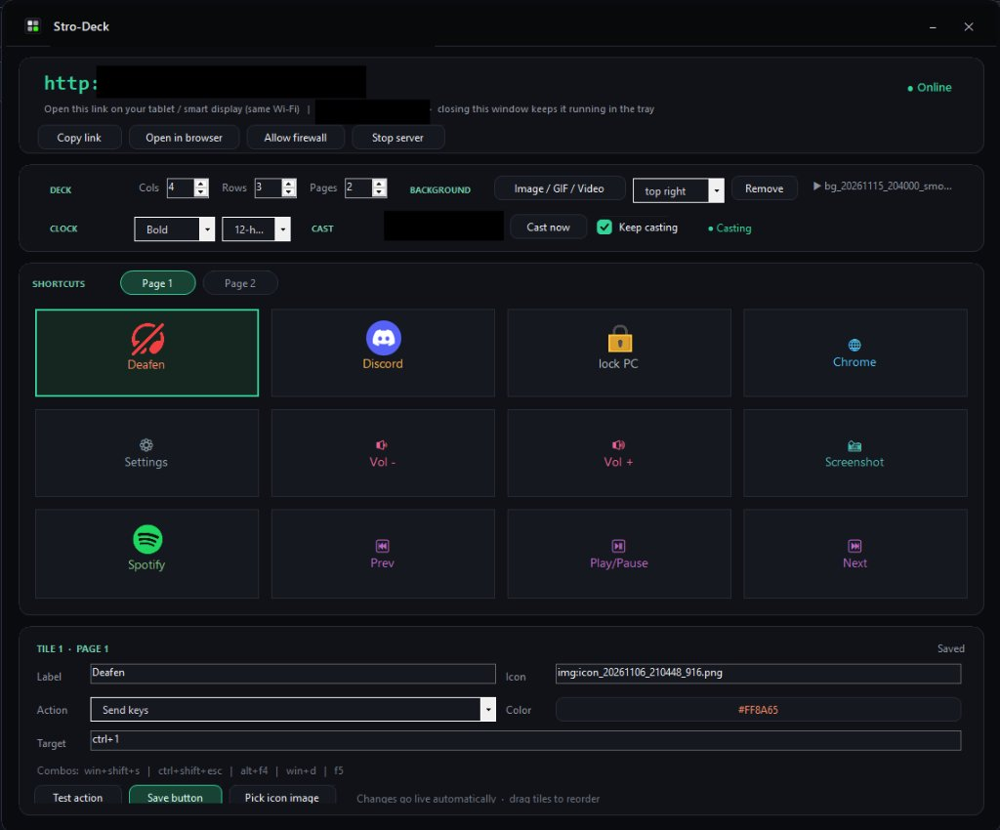
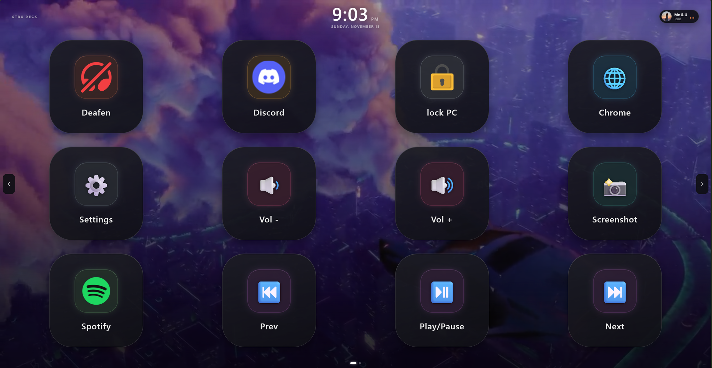
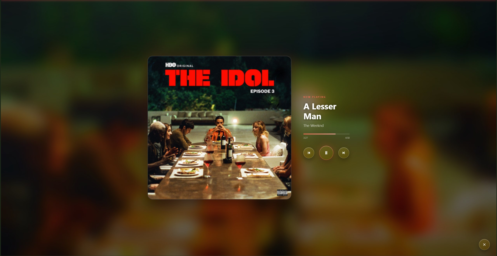

# Stro-Deck

Stro-Deck turns a phone or tablet browser into a customizable control panel for your Windows PC. Set up buttons in the desktop app, then use them over your local network to open apps and sites, trigger shortcuts, or control Spotify and other Windows media sessions.

[Download v1.0.2](https://github.com/yaiha997/Stro-Deck/releases/tag/v1.0.2) · [بالعربي](#بالعربي)



## Quick start

1. Unzip the release and run `Stro-Deck.exe` on Windows.
2. Select **Copy link** and open the link on a device connected to the same local network.
3. Tap a button and enter the 8-digit pairing code shown in the Windows app.

If Windows Firewall asks, allow access on your trusted private network.

## Make it yours

- Edit buttons to open apps, files, and sites, run CMD or PowerShell commands, or send keyboard and media shortcuts.
- Organize buttons across up to four pages. Swipe between pages on the touch display.
- Use an image, GIF, or video as the background. H.264 MP4 works across the widest range of devices.
- Tap the now-playing banner for track details, artwork, and playback controls. Pair the browser first.

<table>
  <tr>
    <th>Touch display</th>
    <th>Now playing</th>
  </tr>
  <tr>
    <td></td>
    <td></td>
  </tr>
</table>

[See the multi-page layout](docs/images/stro-deck-multi-page-grid.png)

## Google Nest Hub

The Hub can display your deck through Google Cast. Use a paired phone or tablet for touch controls.

<details>
<summary>Set up casting with Antigravity</summary>

1. Connect the Windows PC and Hub to the same network. Start Stro-Deck and select **Copy link**.
2. With Python 3 installed, run this in PowerShell from the Stro-Deck folder. Replace the example addresses with your Hub IP and the copied deck URL.

   ```powershell
   powershell -ExecutionPolicy Bypass -File .\setup_mcp.ps1 -HubIp 192.0.2.20 -DeckUrl http://192.0.2.10:8090/
   ```

3. Reload MCP servers in Antigravity. Run `hub_status` to check the connection and `cast_site` to show the deck.

The setup saves your device addresses in your local MCP configuration. Keep that file private. For manual WebView debugging on supported devices, see [hub-check.ps1](hub-check.ps1) and [hub-push.ps1](hub-push.ps1).

</details>

## Security

Viewing the deck is available without pairing. Button actions and media controls require a paired session. The connection uses HTTP, so keep it on a trusted private network and avoid forwarding the port to the internet. To revoke all paired sessions, close Stro-Deck, delete `%LOCALAPPDATA%\Stro-Deck\server.key`, then restart the app.

<details>
<summary>Build and test on Windows</summary>

From PowerShell, with the .NET Framework C# compiler available:

```powershell
powershell -ExecutionPolicy Bypass -File .\build.ps1
powershell -ExecutionPolicy Bypass -File .\test_network_selection.ps1
powershell -ExecutionPolicy Bypass -File .\test_deck_server.ps1
```

Use [package-release.ps1](package-release.ps1) for the release ZIP or [build-installer.ps1](build-installer.ps1) with Inno Setup 6 for a Windows installer. After MCP setup, run `py -3 .\test_mcp_stdio.py` to check the MCP connection locally with a mock Cast command.

</details>

## بالعربي

Stro-Deck يحوّل متصفح الجوال أو التابلت إلى لوحة تحكم لكمبيوتر ويندوز. رتّب الأزرار من برنامج ويندوز عشان تفتح تطبيقات ومواقع، تشغّل اختصارات، أو تتحكم في Spotify.

1. [نزّل الإصدار](https://github.com/yaiha997/Stro-Deck/releases/tag/v1.0.2)، فك الضغط، وشغّل `Stro-Deck.exe`.
2. اضغط **Copy link** وافتح الرابط على جهاز متصل بنفس الشبكة.
3. اضغط أي زر وأدخل رمز الاقتران المكوّن من 8 أرقام من برنامج ويندوز.

استخدمه على شبكة خاصة تثق فيها. تقدر تعرض اللوحة على Nest Hub وتستخدم الجوال للتحكم.

## Share Stro-Deck

[Wide graphic](docs/images/stro-deck-promo-1200x630.svg) · [Square graphic](docs/images/stro-deck-promo-square.svg) · [English and Arabic captions](docs/promotion.md)
